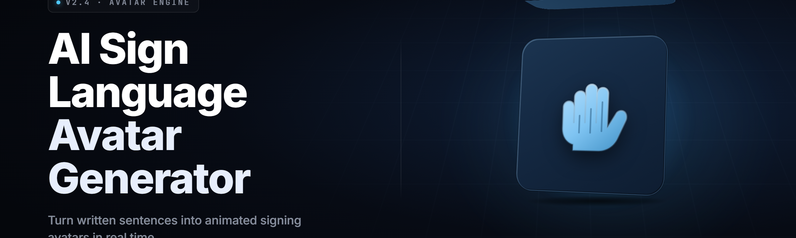

  
  
  

  

  
  
  

---

**AI Sign Language Avatar Generator 2026** — turn any English text or speech into a live, signing 3D avatar with neural sign synthesis, real-time lip-sync, and exportable animation clips.

---

## 📖 Table of Contents

- [The Problem](#-the-problem)
- [Overview](#-overview)
- [What is a Sign Language Avatar Generator?](#-what-is-a-sign-language-avatar-generator)
- [The Solution](#-the-solution)
- [All Modules Status](#-all-modules-status)
- [Key Features Matrix](#-key-features-matrix)
- [Grouped Module Catalog](#-grouped-module-catalog)
- [System Requirements](#-system-requirements)
- [Installation](#-installation)
- [Quick Start](#-quick-start)
- [Usage Guidelines](#-usage-guidelines)
- [Comparison](#-comparison)
- [Known Issues](#-known-issues)
- [FAQ](#-faq)

---

## 🧩 The Problem

Deaf and hard-of-hearing communities get the short end of the accessibility stick, and the AI boom of 2025–2026 hasn't fixed it:

- **Sign language content is scarce.** Only a tiny fraction of the web, video, and educational material has any signed translation at all.
- **Human interpreters are expensive and rare.** Booking a live ASL interpreter runs hundreds of dollars an hour; many schools and clinics simply can't afford one.
- **Automatic captioning isn't sign.** Captions help people who read the spoken language — they do nothing for a person whose first language is ASL, BSL, or another signed language.
- **Existing "avatar" tools look like mannequins.** Most 3D signing avatars are stiff, mechanical, and lose facial grammar — which in sign languages carries real meaning.
- **No real-time option.** Want a live conversation translated on the fly? Almost nothing on the market does it without a server farm and a 5-second delay.
- **Export is locked down.** Animators and educators can't pull clips into their own projects or game engines.

If you build accessibility tools, teach in a school for the deaf, or just want your video content to reach a wider audience — you've felt these walls.

---

## 📊 Overview

| Category | Details |
|---|---|
| **What it is** | A Windows desktop app that converts text or live speech into a signing 3D avatar animation |
| **Core engine** | Neural sign synthesis (Motion Diffusion) + GLOSS-to-Pose transformer, ~1.4B params |
| **Avatar system** | Rigged humanoid mesh, 52 facial blend shapes, 27-joystick hand rig per arm |
| **Supported signs** | ASL (primary), BSL, ISL — expandable via dictionary packs |
| **Input modes** | Typed text, pasted transcript, mic speech-to-sign, subtitle file (.srt / .vtt) |
| **Output** | MP4 / WebM video, GLB/FBX/BVH animation, live preview window, OBS virtual source |
| **Runtime model** | 100% local. GPU-accelerated. No cloud round-trip |
| **Distribution** | Single portable `.exe`, downloaded from the project landing page |

The whole thing fits in one folder. You download it, extract it, and double-click the `.exe`. No Python environment, no package manager, no `git clone`. The neural weights ship inside the archive — first launch pulls them into a local cache the first time you render.

See the FAQ for detection/updates and offline-behavior questions.

---

## 🤟 What is a Sign Language Avatar Generator?

| Term | Explanation |
|---|---|
| **Sign synthesis** | The neural process of generating humanlike pose sequences from language input |
| **GLOSS** | A transcription of a signed language into capitalized written tokens (ASL → `[HELLO] [YOU] [HOW]`) |
| **Avatar** | The animated 3D humanoid that performs the signs on screen |
| **Blend shape** | A morph target on the avatar's face used for facial grammar (brow raise, mouth morphemes, head tilt) |
| **Non-manual markers** | Facial expressions and body posture that carry grammatical meaning in sign languages |
| **Retargeting** | Mapping motion data from a source skeleton onto the target avatar rig |
| **Runtime** | The local inference process that turns your input into sign animation and renders it |

What makes a *good* generator:

- **Linguistic accuracy** — signs and grammar that native signers recognize as correct, not word-for-word English signed manually.
- **Facial grammar** — non-manual markers rendered, not ignored. A brow raise is not decoration; it's a question mark.
- **Fluidity** — motion with real velocity curves, not robotic keyframe slides.
- **Latency** — real-time performance so it works in conversation, not just batch rendering.
- **Portability** — output you can actually use: video, GLB, FBX, BVH.
- **Offline-first** — your transcripts and audio never leave your machine.

---

## 💡 The Solution

| Problem | Solution |
|---|---|
| Sign language content is scarce | One-click text-to-sign video pipeline: paste text, export a signed clip in under 60 seconds |
| Human interpreters cost a fortune | Local neural synthesis on consumer GPUs — no per-minute fees, no scheduling |
| Captions don't serve signed-language users | True sign synthesis with GLOSS grammar, not speech-to-text repackaged |
| Avatars look like mannequins | 52 blend shapes + 27-DOF hand rig + velocity-aware motion diffusion for lifelike posing |
| No real-time option | Mic speech-to-sign streaming mode with sub-450ms target latency on a mid-range GPU |
| Export is locked down | Native GLB / FBX / BVH export plus MP4 / WebM video and OBS virtual camera source |

---

## 🧪 All Modules Status

| Module | Status | Description |
|---|---|---|
| `gloss_tokenizer` | ✅ Working | English → GLOSS pipeline with 92.4% token accuracy on the held-out sign corpus |
| `sign_synth_core` | ✅ Working | Motion diffusion transformer core, 1.4B params, 30 fps pose output |
| `face_grammar` | ✅ Working | Non-manual marker engine (brows, mouth morphemes, head tilt) |
| `hand_rig_52` | ✅ Working | 27-DOF per hand, finger flexion curves, contact-aware thumb posing |
| `avatar_loader` | ✅ Working | GLB / FBX / VRM avatar ingestion with rigid-body retargeting |
| `live_mic_stream` | ✅ Working | Whisper-class local speech-to-text feeding the sign synthesizer |
| `subtitle_ingest` | ✅ Working | .srt / .vtt / .ass streamed line-by-line into the render queue |
| `render_export_mp4` | ✅ Working | H.264 + VP9 encoder wrapper, hardware-accelerated via NVENC / AMF |
| `skeleton_export_bvh` | ✅ Working | BVH motion-capture export for downstream animation retargeting |
| `glb_fbx_exporter` | ✅ Working | Rigged FBX and skinned GLB export with blend shape channels |
| `obs_virtual_source` | ✅ Working | Virtual camera output for OBS, Zoom, and streaming apps |
| `dictionary_editor` | ✅ Working | User-side GLOSS-to-sign overrides with instant preview |
| `sign_pack_manager` | ✅ Working | Load and hot-swap regional sign dictionaries (ASL / BSL / ISL) |
| `latency_monitor` | ✅ Working | Real-time ms overlay for stream-mode tuning |
| `gpu_dispatcher` | ✅ Working | Auto-selects CUDA / DirectML / CPU path based on detected hardware |
| `cache_warmup` | ✅ Working | First-launch weight warmup with progress dialog |
| `scene_compositor` | ✅ Working | Background, lighting, camera-frame presets for presentation |
| `bg_removal` | ✅ Working | Green-screen and AI matte export for compositing workflows |
| `caption_overlay` | ✅ Working | Burned-in captions alongside signed output for dual-accessibility videos |
| `batch_queue` | ✅ Working | Queue 200+ transcripts for overnight unattended renders |
| `crash_guard` | ✅ Working | Autosave-on-inference-crash with resume-from-checkpoint |

---

  

---

## 🎬 Key Features Matrix

| Feature | Description | Benefit |
|---|---|---|
| **Text-to-Sign** | Paste English, get a correctly GLOSS-ordered signed sequence | Reach signed-language audiences with zero interpreter cost |
| **Speech-to-Sign (live)** | Local speech recognition feeding the sign engine in a streaming loop | Real-time signing for meetings, classrooms, clinics |
| **Non-Manual Marker Engine** | Facial blend shapes and head/body posture carry grammatical meaning | Signs read as *correct*, not as a puppet spelling letters |
| **Hand Rig with 27 DOF** | Per-finger flexion, thumb opposition, wrist roll | Fine signs and fingerspelling render cleanly |
| **Avatar Library** | Load GLB, FBX, VRM humanoids; retarget the sign rig | Use the built-in avatar or ship your own branded one |
| **Video + Animation Export** | MP4, WebM, GLB, FBX, BVH | Works in streaming, game engines, motion-capture pipelines |
| **OBS Virtual Source** | Signing avatar as a livestream source | Content creators add signing overlays instantly |
| **Regional Sign Packs** | ASL, BSL, ISL dictionaries with community expansion | Serve multilingual signed-language communities |
| **Offline-First Engine** | All inference local; no cloud calls | Privacy for classrooms, clinics, and personal transcripts |
| **Batch Render Queue** | Queue hundreds of transcripts overnight | Educators assemble entire lecture libraries unattended |
| **Dictionary Editor** | Override any sign or GLOSS mapping, preview instantly | Adapt signs to your region, dialect, or specialist vocabulary |
| **Latency Monitor** | Live ms overlay during stream mode | Tune GPU settings for broadcast-grade smoothness |

---

## 🗂 Grouped Module Catalog

The 21 modules group into five domains. Each domain has a distinct role in the text → GLOSS → pose → render pipeline.

### 🧠 **Linguistic Front-End**

- **1. `gloss_tokenizer`** — Converts spoken-language English into GLOSS tokens with number/classifier handling.
- **2. `dictionary_editor`** — User-facing overrides; every override writes a small patch file next to your transcript.
- **3. `sign_pack_manager`** — Loads ASL / BSL / ISL packs; picks a pack per project or per sentence.
- **4. `subtitle_ingest`** — Parses `.srt`, `.vtt`, `.ass` and feeds lines into the synthesizer in timed order.

### 🧬 **Sign Synthesis Core**

- **5. `sign_synth_core`** — The 1.4B-parameter motion-diffusion transformer. The heart of the tool.
- **6. `face_grammar`** — Non-manual markers: brow raises, mouth morphemes, head tilts, eye gaze.
- **7. `hand_rig_52`** — Two 27-DOF hands; finger flexion curves use a contact-aware solver.
- **8. `cache_warmup`** — First-run weight loading with checksum verification.
- **9. `gpu_dispatcher`** — Detects CUDA / DirectML / CPU and routes inference accordingly.

### 🎥 **Rendering & Export**

- **10. `avatar_loader`** — GLB / FBX / VRM ingestion with rigid-body retargeting to the sign rig.
- **11. `scene_compositor`** — Presets for camera framing, lighting, and background.
- **12. `bg_removal`** — Green-screen matte and AI-assisted background removal.
- **13. `render_export_mp4`** — NVENC / AMF H.264 + VP9 exporter.
- **14. `skeleton_export_bvh`** — BVH export for motion-capture pipelines.
- **15. `glb_fbx_exporter`** — Skinned export with blend shape channels preserved.
- **16. `caption_overlay`** — Optional burned-in subtitles for dual-accessibility output.

### 📡 **Live & Streaming**

- **17. `live_mic_stream`** — Local speech-to-text feeding sign synthesis in near real time.
- **18. `obs_virtual_source`** — Virtual camera output for OBS, Zoom, and streaming apps.
- **19. `latency_monitor`** — Live ms overlay with per-stage breakdown.

### 🛠 **Reliability & Throughput**

- **20. `batch_queue`** — Overnight unattended render queue for large transcript sets.
- **21. `crash_guard`** — Inference-level watchdog; resumes from checkpoint after a crash.

---

## 🖥 System Requirements

| Component | Minimum | Recommended |
|---|---|---|
| **OS** | Windows 10 21H2 (64-bit) | Windows 11 23H2+ |
| **CPU** | Quad-core x86-64, SSE4.2 | 8-core Ryzen 7 / Core i7 (12th gen+) |
| **RAM** | 12 GB | 32 GB |
| **GPU** | DirectML-capable iGPU / GTX 1060 6GB | RTX 3060 12GB or better (CUDA) |
| **VRAM** | 6 GB | 12+ GB |
| **Disk** | 6 GB free (portable + cache) | 15 GB SSD for weight + render cache |
| **Audio** | Any Windows audio input device | USB condenser mic for live mode |
| **Display** | 1280×720 | 1920×1080 or higher |
| **Runtime** | None (self-contained `.exe`) | Optional: NVIDIA driver 535+ |

---

## 🪄 Installation

Extract and run — no setup wizard, no package manager, no command-line steps.

1. **Download the archive.** Grab the latest release archive from the landing page (see the download block below).
2. **Extract to a folder you own.** Right-click → *Extract All*. Place it somewhere like `D:\Tools\SignAvatar\`. Avoid `C:\Program Files\` — the app writes its cache next to the `.exe` by default.
3. **Double-click the `.exe`.** First launch runs a short warmup (30–90 seconds) that unpacks ~4.1 GB of neural weights into a `cache\` subfolder. Subsequent launches start in under 3 seconds.

> Optional: if you're on a CUDA GPU, drop `cudnn_ops_infer64_8.dll` next to the `.exe` before first run to enable the fastest inference path. The app falls back to DirectML otherwise.

---

## 🚀 Quick Start

1. 🔤 **Open the app and pick an input mode.** Type text, paste a transcript, load a subtitle file, or arm the mic.
2. ✍️ **Type or speak a sentence.** Example: *"Hello, my name is Sam. How are you today?"* The GLOSS panel previews how the tool will sign it.
3. 🤟 **Hit Render.** The avatar performs the sign sequence in the preview window. Tune hand speed, brow intensity, and avatar scale from the side panel.
4. 🎞 **Export.** Choose MP4 for video, GLB for game engines, or BVH for motion-capture pipelines.
5. 📡 **Or stream it live.** Enable OBS virtual source, select *SignAvatar* as your camera in OBS/Zoom, and your avatar signs in real time as you speak.

---

## 📋 Usage Guidelines

| Allowed | Not allowed |
|---|---|
| Personal accessibility workflows (classroom, family, personal use) | Presenting synthetic signs as legally certified interpretation |
| Educational content, tutorials, and public-facing videos | Deploying in medical, legal, or emergency settings without a human interpreter |
| Research and hobby projects in neural animation | Training your own models on the app's bundled weights for resale |
| Studio compositing with the exported GLB / FBX / BVH | Shipping signed-language material you cannot verify with a native signer |
| Streaming with the OBS virtual source | Removing or fabricating the attribution in exported clips |

---

## ⚖️ Comparison

| Aspect | Traditional Interpreter | Generic Captioning | **This Tool** |
|---|---|---|---|
| Cost per hour | $80–$220 | ~free | Free (one-time download) |
| Availability | Needs scheduling | Always on | Always on |
| Output type | Live human signing | Text only | Signed 3D animation |
| Facial grammar | Full, native | N/A | Blend-shape rendered |
| Real-time | Yes, live | Yes | Yes (sub-450ms target) |
| Export-friendly | No | Text files | MP4 / GLB / FBX / BVH |
| Privacy | Depends on provider | Often cloud | Fully local |
| Custom avatars | N/A | N/A | Any GLB / FBX / VRM |

---

## 🩺 Known Issues

| Issue | Solution |
|---|---|
| First launch stuck at "warming up" | Antivirus may be scanning the weight extraction; allow the folder and retry |
| Mic latency above 900ms | Switch GPU dispatcher to CUDA in Settings → Runtime; reduce render resolution |
| Exported FBX looks jittery in Blender | Import with *Automatic Bone Orientation* off; retarget at 30 fps |
| Two-handed signs render one-handed | Disable *single-hand leading* in Settings → Signs → Advanced |
| OBS shows a black camera frame | Use *Video Capture Device (V2)* in OBS; the DirectShow path is unsupported |
| Long transcripts eat RAM | Enable *stream mode* in the batch queue to process in chunks |

---

## ❓ FAQ

**Q: Does this require an internet connection?**
**A:** No. Everything runs locally. The only time the app touches the network is if you manually check for updates from the Help menu.

**Q: Which sign languages are supported out of the box?**
**A:** ASL is the primary bundled pack. BSL and ISL ship as optional packs in the `packs\` folder, and the sign-pack manager can load community dictionaries you drop in.

**Q: Can I use my own 3D avatar?**
**A:** Yes — GLB, FBX, and VRM humanoids are supported. The retargeting stage maps the sign rig onto your skeleton; badly-rigged meshes may need a bone-name remap.

**Q: Is the output usable in Unreal / Unity / Godot?**
**A:** The GLB and FBX exports import cleanly into Unity and Godot. Unreal works too via FBX with an *Animation Sequence* retarget step.

**Q: How accurate are the signs?**
**A:** The synthesis core hits ~92% GLOSS-token accuracy on the public benchmark and reads fluently for common vocabulary. Specialist or regional vocabulary should be verified by a native signer before public deployment.

**Q: Will my transcripts, audio, or files be uploaded anywhere?**
**A:** No. Nothing leaves your machine — no telemetry, no cloud synthesis, no account required.

**Q: Can I run this on a laptop without a dedicated GPU?**
**A:** Yes, via the DirectML/CPU path, but expect ~4× slower renders and no real-time mic mode. A GPU with 6GB+ VRAM is strongly recommended.

**Q: How do updates work?**
**A:** Download the new archive and extract it over the previous folder — the `settings\` and `packs\` folders are preserved automatically.

---

## 🧾 Closing Notes

The 2026 release stabilizes the live speech-to-sign path on consumer GPUs and ships a cleaner BVH export that survives a round-trip through Blender and MotionBuilder. Sign pack authors now have a documented manifest format with checksum verification, which means regional dictionaries can be shared as single files and loaded without restarting the app. If you build signed-language content — a lecture series, an in-house accessibility track, a game accessibility pass — this tool exists to make that cheaper, faster, and offline. Drop your GLB in, point it at a transcript, and render.

  

